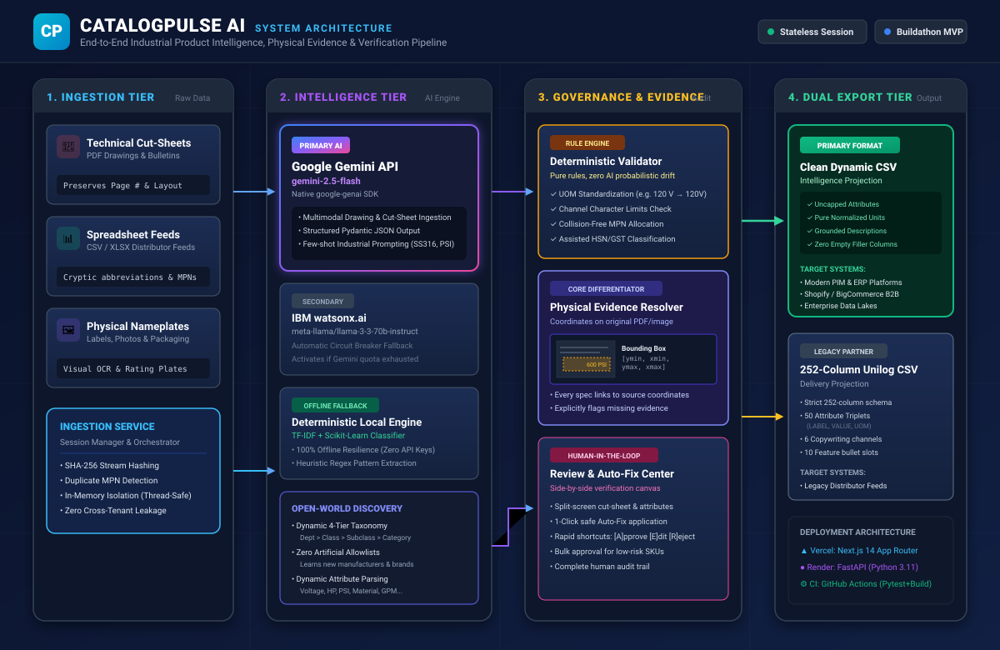
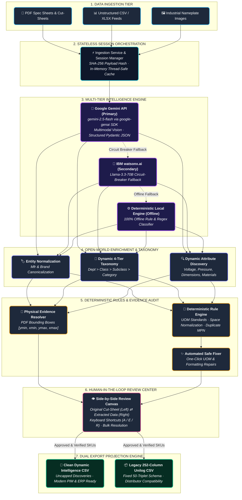

# CatalogPulse AI

> **Tagline:** *From raw industrial data to verified, commerce-ready catalogs.*  
> **Subtitle:** *Industrial Product Intelligence Platform*  
> **Product Category:** AI-Powered Industrial Product Catalog Intelligence & Enrichment Platform  
> **Competition Track:** Startup Buildathon 2026  
> **Status:** Competition MVP — Functional Prototype (Thread-Safe Stateless Session Architecture)  
> **Deployment Configuration:** Backend on **Render** | Frontend on **Vercel**

---

## 1. Product Overview

Industrial manufacturers, suppliers, and distributors manage thousands of technical SKUs scattered across fragmented spreadsheets, PDF specification cut-sheets, and unstructured distributor feeds. Transforming raw product records into standardized, search-ready digital catalogs currently demands extensive manual engineering effort.

**CatalogPulse AI** automates industrial catalog intelligence while preserving physical evidence, deterministic validation, and human oversight.

### Core Value Proposition
> **Upload messy industrial product data. Extract technical attributes. Validate specifications. Review evidence. Export structured catalogs.**

### Target Customers
- **Small & Medium Industrial Manufacturers:** Digitize technical spec sheets and brochures into structured catalogs.
- **Industrial Product Distributors:** Normalize disparate vendor feeds with inconsistent UOMs, taxonomy, and MPNs.
- **Electrical & Mechanical Equipment Suppliers:** Extract multi-tier electrical (voltage, amperage) and mechanical specs with physical verification.
- **Automotive & Hardware Parts Suppliers:** Standardize critical dimensions, materials, and tolerance ratings.
- **B2B Marketplace Onboarding Agencies:** Accelerate vendor catalog ingestion and onboarding.

---

## 2. Technology Stack

- **Backend:** FastAPI (Python 3.11+), Uvicorn, Pydantic v2, Scikit-learn (local taxonomy classifier).
- **Frontend:** Next.js 14 (App Router), React 18, TypeScript, Tailwind CSS, Lucide Icons.
- **Primary AI Provider:** Google Gemini API (`gemini-2.5-flash` via official `google-genai` SDK).
- **Secondary AI Provider:** IBM watsonx.ai (`meta-llama/llama-3-3-70b-instruct`) as optional fallback.
- **Offline / Local Engine:** Deterministic rule and regex classifier (100% offline fallback requiring zero API keys).
- **Testing & Quality:** Pytest (87 backend test items), Next.js compiler & TypeScript typechecker.
- **Deployment Ready:** Blueprint configuration for Render (`render.yaml`) and Vercel (`frontend/vercel.json`).

---

## 3. Core Architecture & Workflow





### Operational Philosophy
> **AI proposes. Rules validate. Evidence supports. Humans decide.**

* **No Hallucinated Specifications:** Attribute extractions preserve document source references with page numbers and coordinate bounding boxes.
* **Open-World Reality:** No restrictive manufacturer allowlists or rigid taxonomies. The engine dynamically learns and isolates real-world industrial categories.
* **Deterministic Guardrails:** Physical unit-of-measurement (UOM) standards, copy channel constraints, and duplicate MPN detection run through mathematical rules, not probabilistic guesses.

---

## 4. Google AI Integration & Prompt Engineering

CatalogPulse AI leverages the Google Gemini API as its primary intelligence engine:

### A. Primary AI Provider: Google Gemini
- **Model Support:** Integrated with `gemini-2.5-flash` (default) via the official `google-genai` SDK, with fallback support for `gemini-2.0-flash` and `gemini-1.5-flash`.
- **Configuration:** Configured via `GEMINI_API_KEY` and `GEMINI_MODEL` in `.env` (defaults to `gemini-2.5-flash`).
- **Multimodal Extraction:** Supports ingesting PDF engineering cut-sheets and industrial photos to extract physical dimensions, electrical ratings, and operational tolerances.
- **Structured Pydantic Extraction:** Prompts enforce strict JSON schemas matching backend Pydantic models (`ProductEnrichmentResponse`), preventing unstructured text drift.
- **Prompt Engineering:** Domain-tailored few-shot examples for industrial notations (e.g., `SS 316`, `120V/60Hz`, `NEMA 4X`, `Class 150#`, `IP67`).
- **Resilient Fallback Hierarchy:**
  1. **Google Gemini** *(Primary provider when `GEMINI_API_KEY` is configured)*
  2. **IBM watsonx.ai** *(Secondary fallback if configured)*
  3. **Deterministic Local Heuristic Engine** *(Offline rule-based classifier ensuring 100% operational continuity even without network access or API credentials)*

---

## 5. Key Features & Differentiators

| Feature | Generic Catalog Tools | CatalogPulse AI |
|---|---|---|
| **Evidence Audit** | Black-box AI outputs | **Physical bounding-box audit** linking attributes to source PDF/image |
| **Taxonomy Model** | Rigid closed allowlists | **Open-world discovery** adapting to novel manufacturers & categories |
| **Validation** | Pure LLM self-evaluation | **Deterministic rule engine** checking UOM syntax, limits & duplicates |
| **Human Review** | Clunky manual spreadsheets | **Side-by-side Review Center** with keyboard shortcuts & bulk fixes |
| **Export Options** | Single fixed format | **Dual export:** Primary Clean Dynamic CSV + Legacy 252-Column Unilog CSV |
| **Offline Resilience** | Fails on API timeout | **Full offline deterministic engine** runs with zero API keys |

---

## 6. Local Development Setup

### Prerequisites
- **Python:** 3.10, 3.11, or 3.12
- **Node.js:** 18+ and `npm`

### 1. Backend Setup
From the repository root:
```bash
# 1. Create and activate a Python virtual environment
python -m venv venv
# Windows:
.\venv\Scripts\activate
# Linux/macOS:
source venv/bin/activate

# 2. Install dependencies
pip install -r requirements.txt

# 3. Configure local environment variables
cp .env.example .env
# Edit .env to add your GEMINI_API_KEY if testing cloud AI

# 4. Start the backend server
python run_backend.py
```
- API Server: `http://localhost:8000`
- Interactive OpenAPI Docs: `http://localhost:8000/docs`
- Health Endpoint: `http://localhost:8000/health`

### 2. Frontend Setup
From the repository root:
```bash
# Option A: From root script
npm run dev

# Option B: From frontend directory
cd frontend
npm install
npm run dev
```
- Web Application: `http://localhost:3000`

---

## 7. Cloud Deployment Configuration

> **Note on Deployment Status:** The application is a competition MVP. Production deployment blueprints are configured in the repository for Render and Vercel.

### A. Backend on Render
The backend includes a [`render.yaml`](render.yaml) blueprint:
1. Connect the repository to [Render](https://render.com) as a Blueprint or Web Service.
2. Build command: `pip install -r requirements.txt`
3. Start command: `python run_backend.py`
4. Health check path: `/health`
5. Configure environment variables:
   - `APP_ENV=production`
   - `PRIMARY_AI_PROVIDER=gemini`
   - `GEMINI_MODEL=gemini-2.5-flash`
   - `GEMINI_API_KEY=<your-key>`
   - `FRONTEND_URL=<your-vercel-domain>`

### B. Frontend on Vercel
The frontend is configured for deployment on Vercel:
1. Import repository in [Vercel](https://vercel.com) with root directory set to `frontend`.
2. Configure environment variables:
   - `NEXT_PUBLIC_API_BASE_URL=https://<your-render-service>.onrender.com/api/v1`
   - `BACKEND_URL=https://<your-render-service>.onrender.com`

---

## 8. Verification & Test Results

### Backend Test Suite
```bash
python -m pytest backend/tests -v
```
**Actual Results:**
- **85 passed**
- **2 skipped** (`test_benchmark_1000_integrity.py` and `test_duplicate_mpn_concurrency.py` scale test marked slow)
- **0 failed** (Total: 87 collected tests)

#### Key Architectural & Regression Tests Covered:
- `test_ai_providers.py`: Validates Google Gemini as primary provider with fallback to watsonx and local heuristics.
- `test_duplicate_mpn_concurrency.py`: Verifies thread-safe collision-free ID allocation for duplicate MPNs across 10 concurrent worker threads.
- `test_review_attribute_safety.py`: Guarantees updating non-existent attributes returns safe `None` without data corruption.
- `test_export_252_columns.py`: Confirms exact 252-column ordering, names, and triplet structure against `output_columns.json`.
- `test_review_bulk_fix.py`: Enforces UI invariants, export header bindings, and bulk auto-fix operations.
- `test_sanity_dataset.py`: Executes end-to-end ingestion, validation, and dual exports against the 15-product industrial sanity fixture.

### Frontend Verification & Build
```bash
# 1. Component & Structure Verification
python frontend/scripts/test_frontend.py
# Result: 49 / 49 frontend files verified

# 2. Production Next.js Build
npm --prefix frontend run build
# Result: Compiled successfully, 13/13 static and dynamic routes generated, 0 type errors
```

---

## 9. Guided Demonstration Walkthrough

A sample industrial dataset is provided at [`sample_data/catalogpulse_industrial_demo.csv`](sample_data/catalogpulse_industrial_demo.csv). It contains 10 realistic industrial SKUs across valves, cutting discs, LED lighting, grade 8 fasteners, industrial circuit breakers, flexible couplings, smart thermostats, and grinding wheels.

### Step-by-Step Demo Script:

1. **Upload Catalog:**
   - Navigate to `/upload` (New Catalog).
   - Drag and drop `sample_data/catalogpulse_industrial_demo.csv`.
   - The system ingests all 10 products, computing session hashes and initializing session isolation.

2. **Inspect Product Intelligence:**
   - Navigate to `/products` (Product Intelligence).
   - View normalized manufacturers, brands, MPNs, dynamically discovered categories, and extracted specifications.
   - Filter by status (`Requires Review`, `Valid`, `Warning`).

3. **Audit Physical Evidence:**
   - Click on the industrial dishwasher SKU (`DW-COMM-200`) or click `/evidence`.
   - The side-by-side Evidence Center displays the source cut-sheet on the left with exact coordinate bounding boxes (`[ymin, xmin, ymax, xmax]`), and extracted attributes on the right.

4. **Human-in-the-Loop Review Center:**
   - Navigate to `/review` (Review Center).
   - Filter by products flagged for review.
   - Review auto-fix recommendations (e.g., standardizing `PSI` to `psi`, normalizing voltage formats).
   - Click **Apply Fix** or approve records using keyboard shortcuts (`A` to approve, `E` to edit, `R` to reject).

5. **Export Intelligence:**
   - Navigate to `/export` (Export Center).
   - Choose between:
     - **Primary Clean Dynamic Intelligence CSV:** Complete dynamic attribute schema for modern data lakes and PIM systems.
     - **Legacy 252-Column Unilog CSV:** Exact legacy schema projection for distributor compatibility.

---

## 10. Operational Boundaries & Honest Limitations

To ensure transparency, CatalogPulse AI operates with clear engineering boundaries:

- **Evidence Transparency:** When evidence is extracted from PDFs or spec sheets, exact page numbers and bounding boxes are presented. If an attribute was inferred from textual descriptions where bounding boxes do not exist, it is explicitly labeled as *Document Evidence Unavailable*—never fabricated.
- **HSN/GST Classification:** HSN and GST codes provided by the platform represent **assisted AI classification suggestions** based on commodity categories. Because CatalogPulse AI is not connected to a live government tax-authority portal, classifications must be audited by human compliance officers before filing.
- **Dynamic Attribute Limits:** The Clean Dynamic CSV accommodates unlimited discovered attributes. The Legacy 252-Column Unilog export enforces an engineering cutoff at 50 attribute triplets (`ATTRIBUTE_LABEL_1..50`) to comply strictly with legacy database schemas.

---

## 11. Roadmap (Planned Integrations)

- [ ] **Direct ERP/PIM Connectors:** Native bi-directional sync with SAP S/4HANA, Akeneo, and Pimcore.
- [ ] **CAD Drawing Attribute Extraction:** Native vector ingestion for AutoCAD and SolidWorks technical drawings.
- [ ] **Automated Syndication Webhooks:** Event publishing to procurement endpoints.

---

## 12. License & Buildathon Context

Developed for the **Startup Buildathon 2026**.  
*From raw industrial data to verified, commerce-ready catalogs.*
